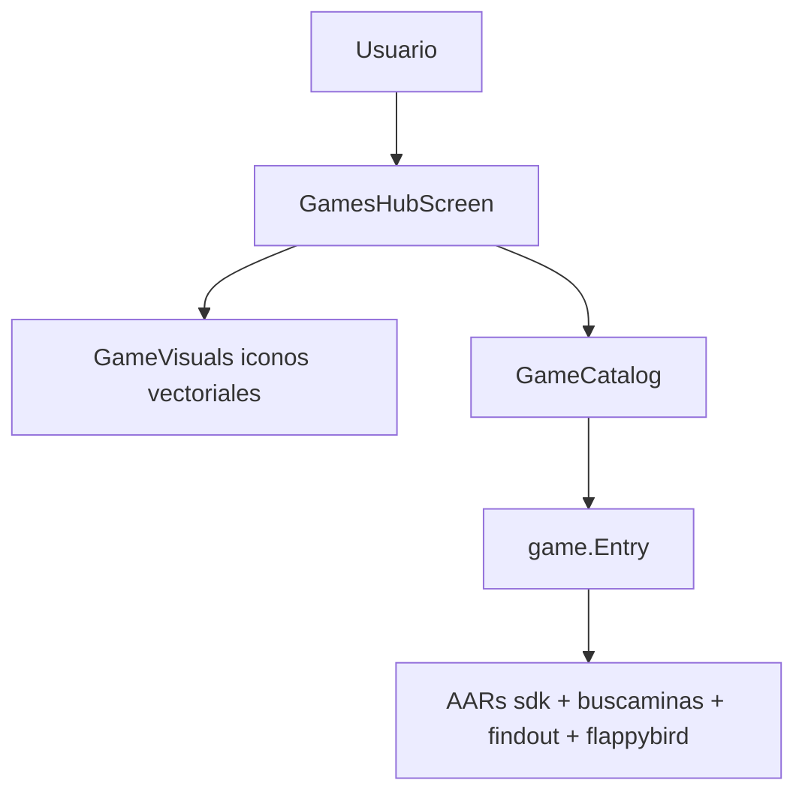
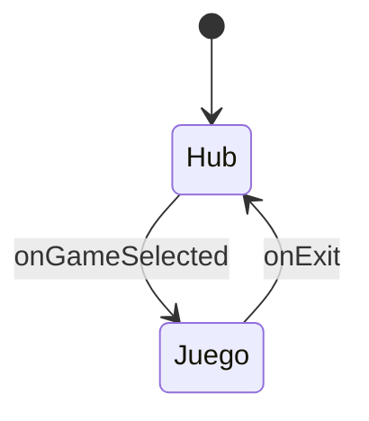

# Estructura — MiniJuegos (host)

## Rol



MiniJuegos solo se ocupa de:

1. Hub / catálogo con UX propia  
2. Iconos vectoriales por `game.id` (`GameVisuals` + `res/drawable/ic_game_*`)  
3. Navegación a `GameModule.Entry`  
4. Tema de marca  
5. Declarar dependencias Maven  

La lógica de cada juego **no** está en este repo. Los iconos del menú viven en el host para no engordar el contrato SDK.

## Árbol del proyecto

```
MiniJuegos/
├── .github/workflows/ci.yml
├── app/
│   └── src/main/
│       ├── java/…/minijuegos/
│       │   ├── MainActivity.kt
│       │   ├── GameCatalog.kt
│       │   ├── presentation/
│       │   │   ├── GamesHubScreen.kt
│       │   │   └── GameVisuals.kt
│       │   └── ui/theme/
│       └── res/drawable/
│           ├── ic_hub_mark.xml
│           ├── ic_game_buscaminas.xml
│           ├── ic_game_findout.xml
│           ├── ic_game_flappybird.xml
│           └── ic_game_default.xml
├── settings.gradle.kts
└── docs/
```

## Navegación host



## Resolución de dependencias

Orden en `settings.gradle.kts`: Google/Maven Central → Packages (SDK + cada juego) → `mavenLocal()`.

## Catálogo + visuals

Para un juego nuevo:

1. Dependencia Maven + línea en `GameCatalog.games`  
2. Vector drawable `ic_game_<id>.xml`  
3. Entrada en `GameVisuals.forId`

## Qué no vive aquí

- Motor / UI interna de cada juego  
- Publicación de AARs de juegos  
- Definición de `GameModule` (está en el SDK)
